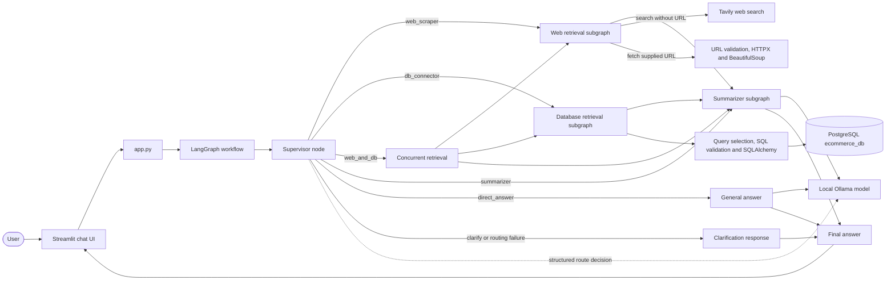
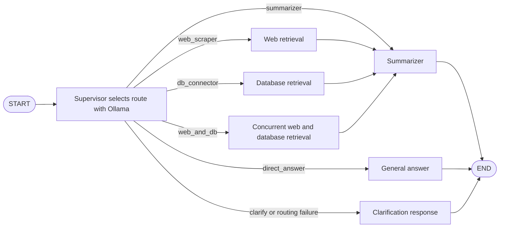

# Architecture

## Routing graph

## Components and contracts

- **Streamlit UI and entry point:** `app.py` accepts a question and answer style, invokes `run_question`, and displays the answer, results, errors, and optional workflow trace.
- **Supervisor node:** asks the configured Ollama model for a structured route decision. It routes to `web_scraper`, `db_connector`, `web_and_db`, `summarizer`, `direct_answer`, or `clarify`; empty input and routing failures go to `clarify`.
- **Web retrieval subgraph:** uses Tavily search when no URL is supplied. For supplied URLs, it validates public HTTP(S) destinations, checks redirects, fetches HTML with size/time limits, and extracts page content.
- **Database retrieval subgraph:** uses deterministic queries for common questions or asks Ollama to draft SQL. It validates SQL, executes it in a read-only transaction with a timeout and row cap, and returns rows plus query metadata.
- **Summarizer subgraph:** summarizes provided text or retrieved web/database evidence with Ollama. It treats retrieved content as untrusted evidence and includes source URLs when available.
- **Combined workflow:** web and database retrieval run concurrently. Their results are passed together to the summarizer.
- **Direct-answer path:** uses Ollama for general questions that do not require external research or private application data.

## LangGraph terms

- **State:** typed dictionary carrying the question, route, retrieval results, trace and final answer.
- **Node:** a function or subgraph that reads state and returns updates.
- **Edge:** a transition between graph nodes.
- **Conditional edge:** selects the next node based on state (`route` in this project).
- **Subgraph:** independently compiled workflow used by the parent graph.
- **Tool:** deterministic function such as `fetch_webpage` or `execute_readonly_query` that performs a bounded operation.
- **LLM usage:** Ollama selects the route, drafts SQL when no deterministic query matches, and produces summaries or general answers. Python code performs the actual web and database retrieval; the model does not execute HTTP or SQL.

## Security notes

The application rejects non-SELECT SQL and multiple statements, blocks common dangerous keywords and system catalog/file functions, applies a row cap and PostgreSQL statement timeout, and requests a read-only transaction. For real deployments, use a separate database role with SELECT grants only on approved tables; the compose demo account owns its schema for setup convenience, so it is not a production least-privilege role. URL checks block private/reserved destinations and validate every redirect, but DNS rebinding protections require additional infrastructure-level egress controls for hostile environments.
